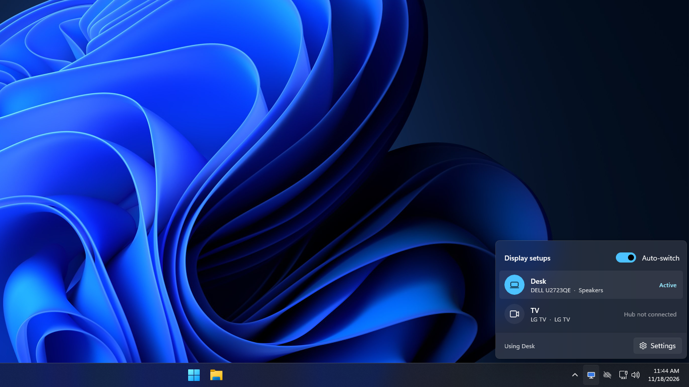
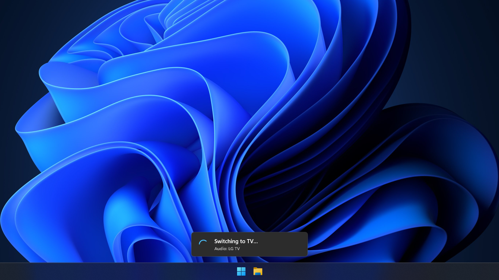

  

<h1 align="center">Display Switchr</h1>

  Plug in your couch hub and your PC switches to the TV, at its full refresh rate, with TV audio.

  

  
  &nbsp;
  
  &nbsp;
  

Moving a PC between a desk and a TV usually means changing the display layout, the refresh rate and the audio device by hand every time, and then again when the TV drops back to 60 Hz. Display Switchr does it for you: put the USB hub for your keyboard, mouse or controller where you play or watch, and the app switches your displays, refresh rates and audio to match whenever that hub connects or disconnects.

## Features

- **Setups:** each setup says which displays are on, which one is the main display and whether they mirror, the refresh rate for each (the highest it supports, a rate you choose, or unchanged), and the default playback device and microphone. Every other display is turned off.
- **Switches when hubs come and go:** a setup applies by default (devices plugged straight into the PC) or when one of its USB hubs is connected. If several hubs are connected, the most recently connected one wins; unplug it and the previous hub's setup comes back, then the default.
- **Built for TVs:** the app waits for a TV to wake, waits for its HDMI audio to appear, keeps setting the refresh rate and audio device until they hold, and checks again afterwards in case the TV drops back to 60 Hz.
- **Switch by hand:** click the tray icon for a tile per setup and an auto-switch toggle; right-click for a quick menu with your setups, Pause, Settings, Open logs folder and Exit.
- **Find a hub by unplugging it:** "Detect by unplugging" in Settings spots which USB device went away.
- **See each switch:** a small popup shows progress while switching and confirms when everything is set. It never takes focus.
- **Fits in:** follows Windows' light or dark theme and language, starts with Windows, and can apply the right setup as soon as you sign in.

## Get it

Get Display Switchr from the **[Microsoft Store](https://apps.microsoft.com/detail/9P1S2QJFXZFW)**. It installs and stays up to date automatically. To build it yourself instead, follow the [development guide](docs/development.md).

Display Switchr collects no telemetry or crash reports.

### Requirements

- Windows 10 (22H2) or Windows 11, on x64 or ARM64.
- A USB hub for the devices you move between places (any hub, or any USB device, that Windows sees connect and disconnect).

## How it works

Windows doesn't allow display changes on the sign-in screen, so that screen keeps your last layout; the app switches once you've signed in. Settings apply and save as soon as you change them.

On Windows 10, Display Switchr's tray icon may start among the hidden icons (the arrow next to the clock). Drag it onto the taskbar to keep it in view.

## Languages

Display Switchr is available in English (United States and Canada), Spanish, French (France and Canada), German, Simplified Chinese, Brazilian Portuguese and Japanese. It follows Windows' language unless you pick one in Settings. Device and setup names are shown as they are.

## Developers

- [Development guide](docs/development.md): build, install, checks, and where the app stores data.
- [Agent instructions](AGENTS.md): architecture, behaviour rules and conventions.

## License

Licensed under the [PolyForm Noncommercial License 1.0.0](LICENSE): free for any **personal and other noncommercial use**, including modifying and redistributing it. **Commercial use is not permitted.** Copyright (c) 2026 Dynamic Solutions.
