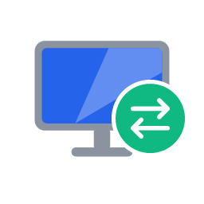
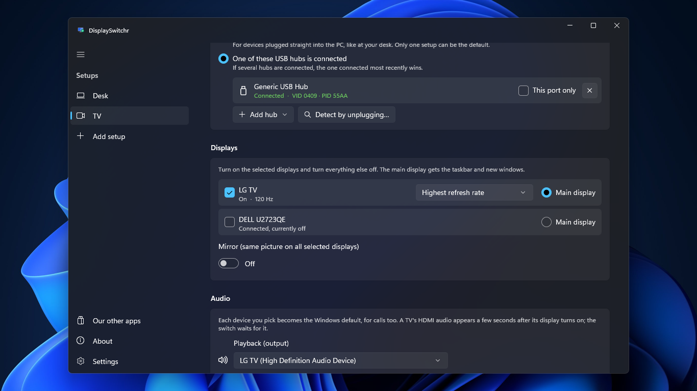

  

<h1 align="center">DisplaySwitchr</h1>

  Plug in your couch hub and your PC switches to the TV, at its full refresh rate, with TV audio.

  

  
  &nbsp;
  
  &nbsp;
  

For anyone who uses one PC at a desk and on a TV. Put the USB hub for your keyboard, mouse or controller where you play or watch. When that hub connects or disconnects, DisplaySwitchr switches your displays, refresh rates and audio to match, so you never change them by hand.

## Features

- **Setups:** each setup chooses which displays are on, the main display, the refresh rate for each, and the playback device and microphone. Displays can mirror, and the refresh rate and audio devices can each be left unchanged.
- **Switches when hubs come and go:** a setup applies by default (devices plugged straight into the PC) or when one of its USB hubs is connected. If several hubs are connected, the most recently connected one wins; unplug it and the previous hub's setup comes back, then the default.
- **Built for TVs:** the app waits for a TV to wake, waits for its HDMI audio to appear, keeps setting the refresh rate and audio device until they hold, and checks again afterwards in case the TV drops back to 60 Hz.
- **Switch by hand:** click the tray icon for a tile per setup and an auto-switch toggle; right-click for a quick menu with your setups, Pause, Settings, Open logs folder and Exit.
- **Find a hub by unplugging it:** "Detect by unplugging" in Settings spots which USB device went away.
- **See each switch:** a small popup shows progress and confirms when everything is set, without taking focus.
- **Fits in:** follows Windows' light or dark theme and language, can start with Windows, and can apply the right setup as soon as you sign in.

## Get it

Get DisplaySwitchr from the **[Microsoft Store](https://apps.microsoft.com/detail/9P1S2QJFXZFW)**. It installs and stays up to date automatically. To build it yourself instead, follow the [development guide](docs/development.md).

DisplaySwitchr collects no telemetry or crash reports.

### Requirements

- Windows 10 (22H2) or Windows 11, on x64 or ARM64.
- A USB hub for the devices you move between places. Any hub works, and so does any other USB device you plug in and unplug.

## How it works

DisplaySwitchr switches as soon as you sign in to Windows; the sign-in screen keeps your last layout. Settings apply and save as soon as you change them.

On Windows 10, the tray icon may start among the hidden icons (the arrow next to the clock). Drag it onto the taskbar to keep it in view.

## Languages

DisplaySwitchr is available in English (United States and Canada), Spanish, French (France and Canada), German, Simplified Chinese, Brazilian Portuguese and Japanese. It follows Windows' language unless you pick one in Settings. Device and setup names are shown as they are.

## Developers

- [Development guide](docs/development.md): build, install, checks, and where the app stores data.
- [Agent instructions](AGENTS.md): architecture, behavior rules and conventions.

## License

Copyright (c) 2026 Dynamic Solutions. Licensed under the [PolyForm Noncommercial License 1.0.0](LICENSE), free for personal and other noncommercial use.
